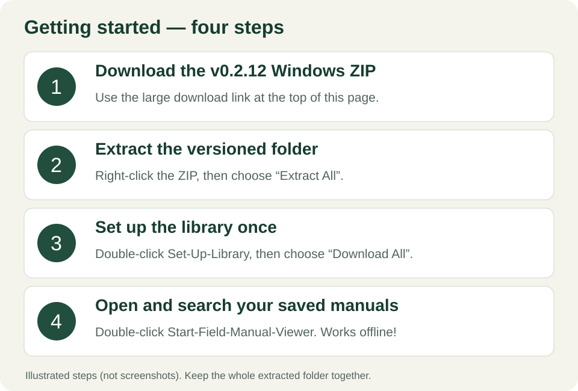

# Field Manual Viewer

**Download field manuals once. Search and read them offline whenever you need them.**

Field Manual Viewer is a portable application for **64-bit Windows**. It saves original PDF and EPUB publications on your computer, provides a searchable library in your regular web browser, and requires no account, AI service, or Python installation.

## Download for Windows

### [⬇ Download Field Manual Viewer Portable v0.2.12 — Windows ZIP](https://github.com/ios5370/Field-Manual-Viewer/releases/download/v0.2.12/Field-Manual-Viewer-Portable-v0.2.12-Windows-x64.zip)

[Verify the v0.2.12 SHA-256 checksum](https://github.com/ios5370/Field-Manual-Viewer/releases/download/v0.2.12/Field-Manual-Viewer-Portable-v0.2.12-Windows-x64.zip.sha256)

[Previous version — v0.2.11 (original release)](https://github.com/ios5370/Field-Manual-Viewer/releases/download/v0.2.11/Field-Manual-Viewer-Windows-x64.zip)

v0.2.11 lacks automatic archive recognition and the newer indexing improvements. Do not downgrade an existing v0.2.12 installation in place; database compatibility with v0.2.11 has not been established.

> **The Windows ZIP includes the portable runtime.** The v0.2.12 asset extracts to **Field Manual Viewer Portable v0.2.12**. The application source is available in this repository for inspection.

## Getting started

1. **Download Field Manual Viewer Portable v0.2.12** using the link above.
2. In your Downloads folder, **right-click the ZIP** and choose **Extract All**. Choose a writable location with plenty of space, such as a folder on an external drive. The extracted folder is **Field Manual Viewer Portable v0.2.12**.
3. Open the extracted **Field Manual Viewer Portable v0.2.12** folder and double-click **Set-Up-Library.bat** (Windows may show it simply as **Set-Up-Library**). Select **Download All**. You can instead try **Download Test Batch (20)** first.
4. To browse and search, double-click **Start-Field-Manual-Viewer.bat** (or **Start-Field-Manual-Viewer**). The library opens in your usual browser.

**Space needed:** The reference collection occupies roughly **70 GB** once downloaded. We recommend **about 100 GB of free space** before beginning. Downloading may take several hours. Keep the computer awake and connected to the internet.

**Need to stop?** Closing Library Setup requests a safe pause. Reopen it later and select **Resume Download**. Previously verified files are retained.

**Once downloaded, the library works offline.** You can search, view and read saved manuals even if the original website becomes unavailable. Keep the entire extracted folder together and, if possible, copy it to a second drive as a backup.

## Moving or recovering an existing library

The original `archive/` folder is the part you must preserve. It contains the PDF and EPUB files themselves.

- **Trying a new version:** extract the new release into a separate version-named folder and move your existing `archive/` folder into it. A move on the same drive is instant and does not duplicate the documents. You can move `data/` as well to keep the original catalog metadata and search indexes, but the viewer can rebuild both offline from the archive.
- **Upgrading in place without moving 70 GB:** close the viewer and Library Setup. Extract the new release to a temporary folder, then copy only the new application files and `runtime/` over the old installation. Leave the existing `archive/` and `data/` folders untouched.
- **Only the archive survived:** put it in the correct place, open the viewer, and wait while it checks the files and rebuilds the catalog and search index locally. Nothing is downloaded.
- **Adding or removing files while the viewer is open:** choose **Rescan library** in the viewer, or refresh the browser page.
- **Recovered entries** are labelled **Recovered catalog**. Their titles may come from the filename, the document's embedded metadata, or a surviving manifest rather than the publisher catalog.
- **Do not use Download All to recover an existing archive.** Recovery is automatic; Download All is only for acquiring publications that are not already present.

The first recovery of a large copied archive reads each new or changed file once to calculate its checksum and build its search index. Later launches use the recorded checksums and are fast.

## How startup and checking work

- A normal launch shows the saved catalog immediately. A lightweight archive check then runs in the background and updates the library when files were added, removed, changed, or restored.
- An archive-only recovery cannot show unknown documents instantly. Recovered publications appear progressively while the catalog and search index are rebuilt.
- **Rescan library** requests a quick filesystem check. For a full checksum verification, close the viewer and use **Library Setup > Advanced > Check saved file integrity**.
- Browser filters and searches use the saved catalog and do not start repeated archive scans. Refreshing the page requests one throttled background check; multiple tabs share it.
- If a document disappears or changes, its catalog record and index are retained. While the background check catches up, a card may briefly remain visible, but search results and the reader refuse stale content.
- If the whole archive drive is disconnected, the last known catalog remains visible with an explicit warning. Reconnect the drive; no records are destroyed.

## A few useful details

- **No manuals are included in the ZIP.** The setup program retrieves them from the original public source while that source is available.
- **No regular updates are needed.** Library Setup is primarily a one-time tool; you will normally use the browser viewer afterward.
- **Nothing to install system-wide.** The release contains the application and its Windows runtime.
- **The folder is portable.** Close the viewer and Library Setup before copying or moving the whole folder to another drive. All library paths are relative, and the launcher replaces stale saved server information automatically.
- **Windows security prompts:** Only download from the Releases link on this page. The application is not code-signed; Windows may display an unfamiliar-app warning. Do not disable your security software.

## Credits and license

Thanks to [T.REX ARMS Field Manual Vault](https://www.trex-arms.com/field-manual-vault) for collecting and organizing the source publications. **Field Manual Viewer is an independent project, not affiliated with or endorsed by T.REX ARMS.** Each publication retains its own rights and terms.

Application code: [MIT License](LICENSE). Third-party software and license notices are included with the portable package.

## Source and building

Application code is [MIT licensed](LICENSE) and fully public, including the automated tests and build scripts.

- [BUILDING.md](BUILDING.md) — prepare a development environment, run the tests and build the Windows ZIP.
- [CONTRIBUTING.md](CONTRIBUTING.md) — how to report a problem or propose a change.
- [THIRD-PARTY.md](THIRD-PARTY.md) — runtime components and their upstream sources.
- [VALIDATION.md](VALIDATION.md) — what has been verified and what has not.

A source checkout is not the user download: it contains no Python runtime and no manuals. Ordinary users should use the Windows ZIP linked above.

